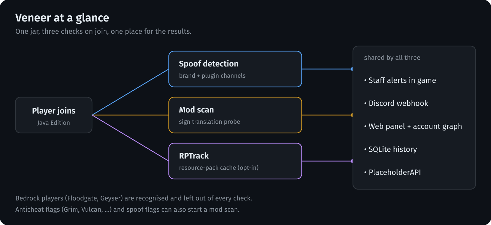
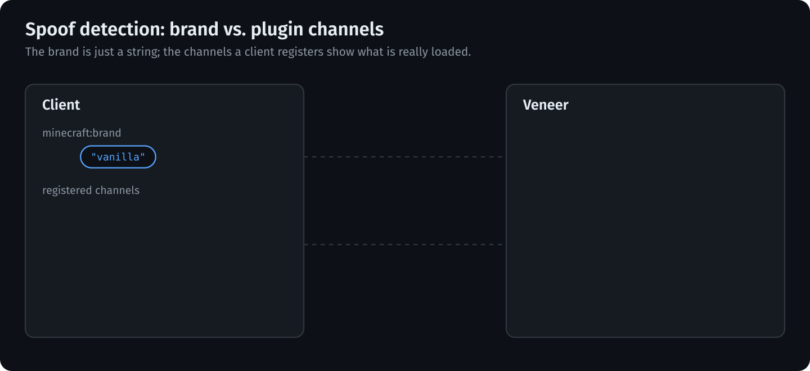
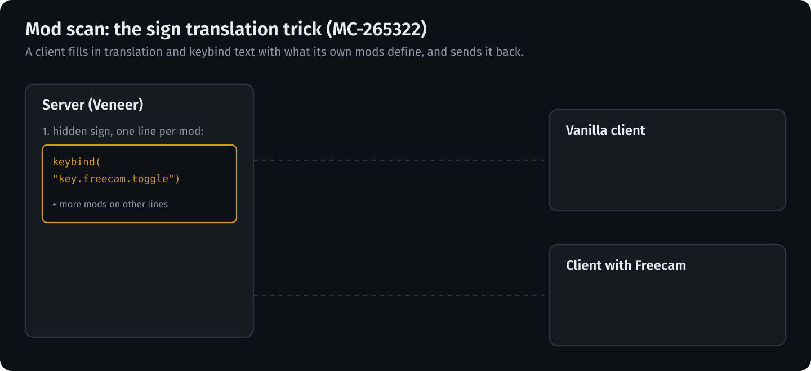
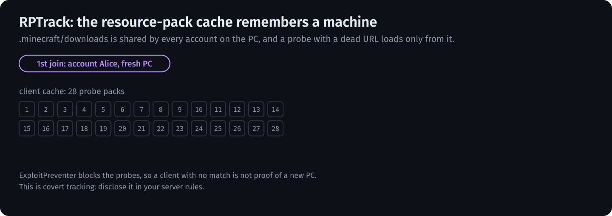

<div align="center">

# Veneer

**Catch clients that aren't what they claim to be.**

Client spoof detection, mod detection and cache-based account linking for Paper, Spigot and Folia, in a single jar.


</div>

> **Status:** beta. Tested on Paper/Purpur and Folia 1.21.11 with test clients and real clients (including ViaFabricPlus and ViaProxy), not yet on a busy public server.



---

## Features

| Module | What it does |
|---|---|
| **Spoof detection** (from AntiSpoof) | Compares the client brand and registered plugin channels against what the claimed client can actually send. Catches fake `vanilla`, fake Fabric/Forge/Lunar, blocked or required channels, Geyser impersonation. Uses PacketEvents and the `minecraft:brand` channel. |
| **Mod detection** (from CheckHacks) | Finds installed mods through the sign translation vulnerability (MC-265322). Hacks are defined in config, results are stored in SQLite. Clients older than `hacks.detection.min-client-version` (default 1.17) are not scanned: they do not answer the probe sign. |
| **Language and version check** | `/hacklang` reads the client language, and from the same sign the client's real game version: key bindings and removed keys work in any language and tell apart every release from 1.21.5 to 26.3 (except 1.21.6-1.21.8 and 1.21.9/1.21.10), keys added in each version narrow en_us clients down to nearly the release. A version that does not match the protocol the player connects with points to ViaFabricPlus, ViaProxy and the like; an alert and an optional command follow. |
| **Web panel** | Overview counts, scan history with filters, manual scans that show up as soon as they finish, scan deletion, player pages (first and last join, client brand, channels and real version, detected mods, fingerprint, addresses, possible alts), name suggestions in search, a list of every mod detected, and a 3D graph of linked accounts (shared addresses, RPTrack fingerprints and the same client brand and channels) with player heads, filters by link type, strength and last seen, and search by name or IP. Each address shows its provider, AS number and country; a shared address of a VPN, Cloudflare WARP or hosting provider counts as a weaker link. The panel follows `general.language` (English and Russian). |
| **Anticheat bridge** | Flags from Grim (event bus), Vulcan, Spartan, Matrix, Intave and AAC can trigger a mod scan. A spoof flag can also queue one. |
| **RPTrack** | Links accounts and IPs of the same Minecraft installation through its resource-pack download cache, and detects LiquidBounce's local server. **Off by default.** See [RPTrack](#rptrack). |
| **Integrations** | LuckPerms (primary group), PlaceholderAPI (`%veneer_*%`), Floodgate/Geyser, Discord webhooks, Folia-aware scheduling. |

## How it works

### Spoof detection



The `minecraft:brand` string is whatever the client chooses to send. The plugin channels it registers are harder to hide, because the mods need them to work. Veneer checks the two against each other and against the rules for each known client brand in `spoof.client-brands`: required channels, blocked channels or a channel whitelist.

### Mod scan



Veneer places a sign next to the player with a translation or keybind key from each mod on its lines, opens the sign editor and at once replaces the sign with air on the client. The editor closes and the client sends the sign text back, filled in from its own language files and key bindings. A key no mod defines comes back as is; a key a mod defines comes back as the mod's text or bound key. The player sees, at most, a flicker. Hacks are defined in `hacks.detection.hacks` (`TRANSLATE`, `KEYBIND` or `METEOR` mode); a client with ExploitPreventer, which blocks the trick, shows up as `PROTECTED`.

## Install

1. Drop `veneer-<version>.jar` into `plugins/` and start the server (or `veneer-<version>-lite.jar` together with the PacketEvents plugin, see [Build](#build)).
2. Edit `plugins/Veneer/config.yml`, then apply it with `/veneer reload`. Requires Paper, Spigot or Folia 1.21+ on Java 21.
3. Optional: install LuckPerms, PlaceholderAPI, Floodgate/Geyser, ViaVersion or an anticheat. Veneer picks them up automatically.

## Commands

| Command | Permission | Description |
|---|---|---|
| `/veneer info <player>` | `veneer.admin` | One report per player: client brand and channels, spoof status, latest mod scan, RPTrack link |
| `/veneer alerts` | `veneer.alerts` | Toggle your own staff alerts (spoof, mod scan and RPTrack share one switch) |
| `/veneer reload` | `veneer.admin` | Reload `config.yml` and the language files for every module |
| `/veneer version` | `veneer.admin` | Running and latest release |
| `/spoof` | `veneer.spoof.use` | Inspect client brand and channels, re-run spoof checks (`check`, `runcheck`, `channels`, `brand`) |
| `/hackcheck <player> [hacks]` | `veneer.hacks.check` | Scan a player for mods |
| `/hacklang <player>` | `veneer.hacks.lang` | Check a player's client language |
| `/hackeditor` | `veneer.hacks.editor` | Link to the web panel: scan history and manual scans |
| `/rptrack <player>` | `veneer.rptrack` | Show a player's cache fingerprint and linked accounts |

Other permissions: `veneer.spoof.admin`. Bypass (all default `false`, not in `veneer.*`): `veneer.bypass` (everything), `veneer.bypass.<spoof|hacks|rptrack>` (that module, join and later), `veneer.bypass.<type>.join` (join-time check only). The most specific bypass that is set wins, so `veneer.bypass` true with `veneer.bypass.hacks` false still scans mods, and nodes set on the player come before group ones (a player's own `veneer.bypass` beats a group's `veneer.bypass.hacks` false); `/veneer info <player>` shows the bypasses in effect and the node that grants each; `veneer.*`, `*` and other wildcards above `veneer.bypass` never grant a bypass, also with LuckPerms (read through its API when installed). Manual scans (`/hackcheck`, `/hacklang`, web panel) ignore bypasses. Wildcards: `veneer.spoof.*`, `veneer.hacks.*`, `veneer.web.*`, `veneer.*`.

Web panel rights (default op) are taken from the player when `/hackeditor` issues the token: `veneer.web.scan` (run scans), `veneer.web.delete` (delete scans), `veneer.web.links` (account graph), `veneer.web.ips` (see IP addresses; without it the graph hides them). Without any of them the token still shows the scan history.

## Configuration

One file, `plugins/Veneer/config.yml`, one section per part:

```
general:    # language, prefix, debug, alerts, Bedrock detection, shared Discord webhook, update checker
spoof:      # brand/channel rules, punishments, Discord alerts            (enabled: true)
hacks:      # hack definitions, auto-checks, anticheat hooks, web panel   (enabled: true)
rptrack:    # resource-pack cache tracking                                (enabled: false)
```

- Settings that more than one module needs live in `general` once: the Bedrock rules, the staff alert switch, the debug flag and a default Discord webhook (a module's own URL wins when set).
- Settings missing from your file are added from the defaults on start and on reload, comments included. Unknown settings are reported in the console.
- Turning a module on or off needs a restart; everything else applies with `/veneer reload`.
- The mod scan messages live in `plugins/Veneer/messages/<lang>.yml` (en, ru, de, es, fr, it, br, lolcat, uwu).

## PlaceholderAPI

| Placeholder | Value |
|---|---|
| `%veneer_brand%` | Client brand |
| `%veneer_channels%`, `%veneer_channels_count%` | Registered plugin channels |
| `%veneer_is_spoofing%`, `%veneer_is_bedrock%` | `true` / `false` |
| `%veneer_client_type%` | Client type seen by the mod scan |
| `%veneer_alerts%` | `on` / `off` for the viewer |
| `%veneer_group%` | LuckPerms primary group |
| `%veneer_rptrack_packs%`, `%veneer_rptrack_linked%`, `%veneer_rptrack_liquidbounce%` | RPTrack result for the player |

## RPTrack

The Minecraft client caches downloaded resource packs by SHA-1 in `.minecraft/downloads`, shared across accounts. On join, Veneer offers 28 probe packs with a known hash and an unreachable URL; a pack answers *loaded* only if it is already cached. A fresh client is assigned a random subset of 6 packs that it really downloads, and later logins on any account or IP reproduce that subset. The technique is described in [this write-up](https://alaggydev.github.io/posts/cytooxien/).



Probe packs and a small pack that hides the "failed to download" toast must be downloadable by clients. Point `public-url` at `localhost` (e.g. `http://localhost:8123`) and Veneer serves them itself on that port, sending clients to the host they joined with. With any other URL no server is started: host `plugins/Veneer/rptrack/fp/` (exported on start) at `<public-url>/fp/`. Set it up in `rptrack`:

```yaml
enabled: true
public-url: "http://localhost:8123"   # localhost = built-in server on this port
track: 28                             # probe packs checked on every join
send: 6                               # packs a fresh client is sent (<= track)
match: 5                              # cached packs that must overlap to link accounts (<= send)
debug: false                          # log every step; also turns on the experimental unique-set mode (direct and indirect links, `match` unused)
```

> **Privacy:** this is covert tracking of players. Disclose it in your server rules or privacy policy. The ExploitPreventer mod blocks the probes, so the absence of a match proves nothing.

## Build

```
mvn -q -DskipTests package
```

Produces two jars (Java 21 or newer):

- `target/veneer-<version>.jar` (about 24 MB): PacketEvents bundled and relocated, nothing else to install.
- `target/veneer-<version>-lite.jar` (about 1.5 MB): runs on the [PacketEvents plugin](https://modrinth.com/plugin/packetevents), which must be installed; without it Veneer disables itself. Use it when the server already has PacketEvents or you want to update PacketEvents on its own.

## Notes

- The web panel (`/hackeditor`) listens on `127.0.0.1` by default; set `hacks.web-editor.bind` to `0.0.0.0` (and put it behind HTTPS) to reach it from elsewhere. Access needs the one-time token from the command. Join addresses and skins are kept for `hacks.web-editor.links.retention-days` (90) after the player was last seen, scans for `hacks.web-editor.history.retention-days` (180).
- The provider and country data (about 50 MB) is downloaded to `plugins/Veneer/geo/` through jsDelivr and refreshed weekly (`hacks.web-editor.links.ip-database`, on by default; the plugin works without it). The country is where the network is registered, not a precise location. Which providers count as weak is set by `weak-provider-asns` and `weak-provider-keywords`, the weight factor by `weak-provider-factor` (0.3). Client links need the spoof module and are recorded when a player leaves.
- To translate the panel, add `src/main/resources/web/lang/<language>.json` (English text as keys, see `ru.json`).
- Version `0.9.5` is independent of the originals (AntiSpoof 1.2.7, CheckHacks 1.3.1).
- **Folia:** every task goes through `FoliaScheduler` (global, per-entity and async schedulers; Bukkit's scheduler is no longer used anywhere), and punishments run as console commands on the global region. Tested on Folia 1.21.11 (mod scan, language check, web panel scans, death, world change and quitting mid-scan). A probe sign Folia does not let the plugin remove on shutdown is removed on the next start.
- Compiled against Paper API 1.21.4, `api-version: 1.21`. Legacy 1.8.x servers are untested.

## Credits and license

Veneer merges two open-source plugins and adds new modules:

- **AntiSpoof** by GigaZelensky (GPLv3)
- **CheckHacks** by Branduzzo (MIT)

The web panel bundles [3d-force-graph](https://github.com/vasturiano/3d-force-graph) and [three.js](https://github.com/mrdoob/three.js) (both MIT, texts in `src/main/resources/web/THIRD-PARTY-LICENSES.txt`). IP provider data: [IPtoASN](https://iptoasn.com) (PDDL); country data: [geo-whois-asn-country](https://github.com/sapics/ip-location-db) (CC BY 4.0, from NRO), both via ip-location-db.

The combined work is released under **GPLv3**, see `LICENSE`; the CheckHacks MIT text is appended there for attribution.
